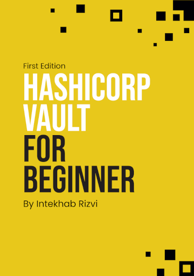

# HashiCorp Vault for Beginners - First Edition

### A practical, hands-on guide to HashiCorp Vault

This is the companion repository for **"HashiCorp Vault for Beginners"**, a practical, Docker-based book that helps developers, DevOps engineers, and security teams learn Vault through hands-on exercises.

The repository contains the exercises, Docker configurations, and step-by-step commands used throughout the book, so you can follow along without modifying your local system.

---

## About the Book

HashiCorp Vault can be difficult to approach at first. This book covers the essentials in a structured way, from installing Vault with Docker to building automation pipelines with Vault Agent, using AppRole authentication, encrypting data with the Transit engine, and deploying Vault in production with practical security guidance.

The focus is on command-line usage, real configurations, and practical scenarios.



---

## Book Chapters

| Chapter | Title                                                              | Codes |
| ------- | ------------------------------------------------------------------ | ----- |
| 1       | Introduction to HashiCorp Vault                                    |  |
| 2       | Installing Vault Using Docker                                      | [Codes](https://github.com/intekhabrizvi/vault-beginner/tree/master/chapter-02) |
| 3       | Vault Initialization and Logging In                                | [Codes](https://github.com/intekhabrizvi/vault-beginner/tree/master/chapter-03) |
| 4       | Understanding Shamir's Secret Sharing and Rekeying Vault           | [Codes](https://github.com/intekhabrizvi/vault-beginner/tree/master/chapter-04) |
| 5       | Storing Your First Secret                                          | [Codes](https://github.com/intekhabrizvi/vault-beginner/tree/master/chapter-05) |
| 6       | KV v2 Versioned Secrets                                            | [Codes](https://github.com/intekhabrizvi/vault-beginner/tree/master/chapter-06) |
| 7       | Secrets Engine and Paths                                           | |
| 8       | Authentication Methods: Giving Others Access                       | [Codes](https://github.com/intekhabrizvi/vault-beginner/tree/master/chapter-08) |
| 9       | Understanding Vault Policies                                       |  |
| 10      | Policies in Action                                                 | [Codes](https://github.com/intekhabrizvi/vault-beginner/tree/master/chapter-10) |
| 11      | Accessing Vault Using the Browser-Based UI                         |  |
| 12      | Understanding Dynamic Secrets                                      |  |
| 13      | Dynamic Secrets in Action                                          | [Codes](https://github.com/intekhabrizvi/vault-beginner/tree/master/chapter-13) |
| 14      | Fine-Tuning and Access Control on Dynamic Secrets                  | [Codes](https://github.com/intekhabrizvi/vault-beginner/tree/master/chapter-14) |
| 15      | Leasing, TTL, and Vault's Secret Lifecycle                         |  |
| 16      | Dynamic Secrets with PostgreSQL                                    | [Codes](https://github.com/intekhabrizvi/vault-beginner/tree/master/chapter-16) |
| 17      | Dynamic Secrets with MongoDB                                       | [Codes](https://github.com/intekhabrizvi/vault-beginner/tree/master/chapter-17) |
| 18      | Getting Started with the Vault API: Your First Step to Automation  | [Codes](https://github.com/intekhabrizvi/vault-beginner/tree/master/chapter-18) |
| 19      | AppRole Authentication Method: Vault Meets Automation              | [Codes](https://github.com/intekhabrizvi/vault-beginner/tree/master/chapter-19) |
| 20      | Vault Agent and Templating: Bridging the Gap for Legacy Apps       | [Codes](https://github.com/intekhabrizvi/vault-beginner/tree/master/chapter-20) |
| 21      | Transit Secrets Engine: Encryption as a Service                    | [Codes](https://github.com/intekhabrizvi/vault-beginner/tree/master/chapter-21) |
| 22      | Understanding Vault Audit Devices                                  | [Codes](https://github.com/intekhabrizvi/vault-beginner/tree/master/chapter-22) |
| 23      | Revoking and Regenerating the Root Token                           | [Codes](https://github.com/intekhabrizvi/vault-beginner/tree/master/chapter-23) |
| 24      | Production Deployment of HashiCorp Vault on Ubuntu LTS             | [Codes](https://github.com/intekhabrizvi/vault-beginner/tree/master/chapter-24) |
| 25      | Production Deployment of HashiCorp Vault Using Docker              | [Codes](https://github.com/intekhabrizvi/vault-beginner/tree/master/chapter-25) |
| 26      | Production Hardening Guide                                         | [Codes](https://github.com/intekhabrizvi/vault-beginner/tree/master/chapter-26) |
| 27      | Creating PGP Keys for Vault Security                               | [Codes](https://github.com/intekhabrizvi/vault-beginner/tree/master/chapter-27) |

---

## Getting Started

All exercises run on Docker, so no local Vault installation or OS-level dependencies are required. From a chapter directory that includes a Docker Compose file, run:

```bash
docker compose up -d
```

---

## Directory Structure

```bash
vault-beginner/
├── chapter-02/
├── chapter-03/
├── ...
├── chapter-21/
├── ...
└── chapter-27/
```

Each chapter folder may include:

* Vault CLI commands
* Docker setup (where applicable)
* Sample policy files
* API request examples (using `curl`)
* Additional notes and troubleshooting guidance

---

## Download the Book

The book is available free of charge in PDF format:

[HashiCorp Vault for Beginners (PDF)](Hashicorp-vault-for-beginner.pdf)

If you would like to print or translate the book, please contact the author first.

---

## About the Author

I am a senior software engineer focused on security and automation. I wrote this book to make Vault approachable and practical for people who need to use it in real projects.

---

## Contact

* Website and blog: [www.intekhabrizvi.com](https://www.intekhabrizvi.com)

---

## Support This Project

If this repository or the book has been useful to you, please consider starring the repository on GitHub.
